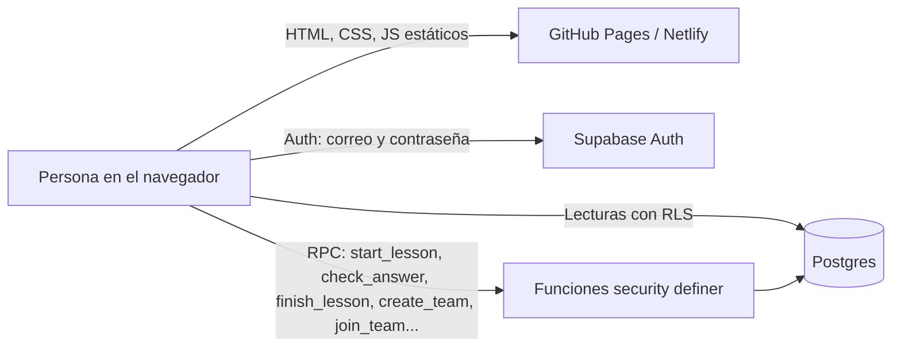

# Arquitectura · Ruta de Dominio IA

Plataforma web para aprender IA con Claude. Cada persona se registra, define un reto de horas por semana y demuestra lo que sabe en lecciones cortas estilo Duolingo. Puede trabajar sola o en equipo.

## Vista general

- **Frontend sin compilación:** módulos ES en `js/` y estilos en `css/`, con una sola dependencia (supabase-js, desde CDN con SRI).
- **Backend:** Supabase. La lógica que da horas, dominio, insignias o permisos se ejecuta **solo** en funciones del servidor.
- **Fuente de verdad:** el catálogo de cursos (horas oficiales) y las preguntas viven en la base de datos. `js/catalog.js` solo tiene datos de presentación y el contenido de práctica.

## Modelo de datos

| Tabla | Para qué | Quién puede leer | Quién puede escribir |
|---|---|---|---|
| `courses` | Cursos y horas oficiales | Usuarios con sesión | Solo el administrador (SQL) |
| `questions` | Banco de Demuestra, con respuestas | Nadie desde la web | Solo el administrador (SQL) |
| `profiles` | Nombre, avatar y reto | Tú y tu equipo | Tú, en columnas permitidas |
| `teams`, `team_members` | Equipos y membresía | Tu equipo | Solo mediante RPC |
| `lesson_sessions` | Estado de cada lección en curso | Nadie desde la web | Solo mediante RPC |
| `module_mastery` | Módulos dominados, XP y horas acreditadas | Tú y tu equipo | Solo mediante RPC |
| `training_results` | Prácticas: quiz, alucinaciones, prompts y retos | Tú y tu equipo | Tú, solo a tu nombre |

## Cómo se mide el avance

1. El servidor califica cada respuesta (`check_answer`). El navegador nunca recibe la respuesta correcta antes de contestar.
2. Al aprobar un módulo (`finish_lesson`), el servidor acredita `horas del curso ÷ número de módulos`. Repasar un módulo ya dominado no vuelve a sumar horas.
3. **Cumplimiento** = horas acreditadas ÷ horas que deberías llevar hoy según tu reto.
4. Al dominar todos los módulos de un curso se gana su **insignia**.

## Decisiones (ADR)

| # | Decisión | Por qué | Consecuencia |
|---|---|---|---|
| 1 | Calificar en el servidor | Un examen calificado en el navegador se puede falsear | Cada respuesta es una llamada; la latencia es aceptable |
| 2 | Las horas se acreditan al demostrar, no se registran a mano | Medir conocimiento real, no tiempo declarado | El reto se mide con horas demostradas |
| 3 | Banco de preguntas fuera del repositorio | El repositorio es público (requisito de GitHub Pages gratis) | La carga se hace con `supabase/private/2_cursos_y_preguntas.sql` |
| 4 | Una persona pertenece a un solo equipo | Simplicidad y privacidad | Para cambiar de equipo primero sale del actual |
| 5 | Sin framework ni compilación | Sostenibilidad, cero mantenimiento de dependencias | Módulos ES nativos |

## Roadmap sugerido

1. **Netlify con repositorio privado.** Protege mejor el historial y permite cabeceras de seguridad reales (ver `netlify.toml`).
2. **SMTP propio.** El correo de Supabase por defecto tiene límites muy bajos, así que conviene usar Resend o SendGrid para confirmaciones y recuperación de contraseña.
3. **Banco de preguntas ampliado.** Tener 6 o más preguntas por módulo y que el servidor elija 3 al azar en cada intento.
4. **Panel de administración del equipo:** exportar a Excel y ver el progreso por curso.
5. **Recordatorios semanales** por correo, con una Edge Function programada.
